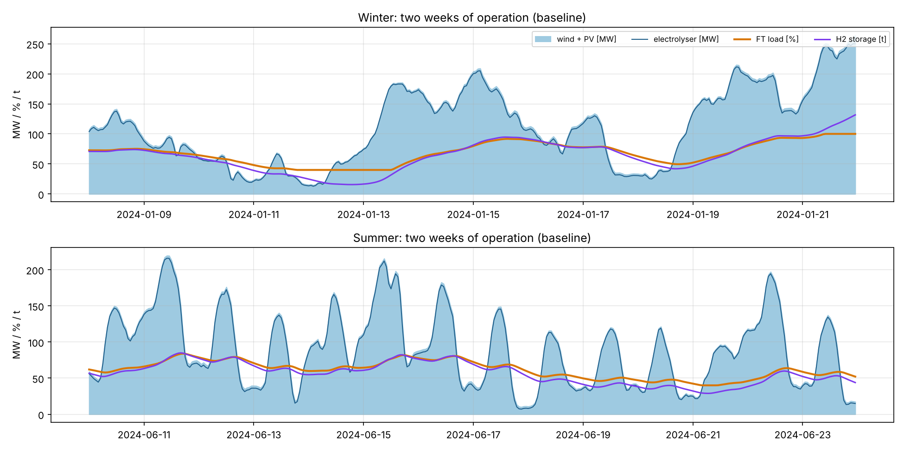
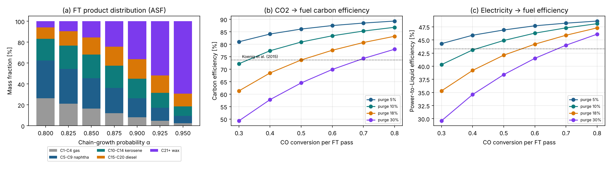
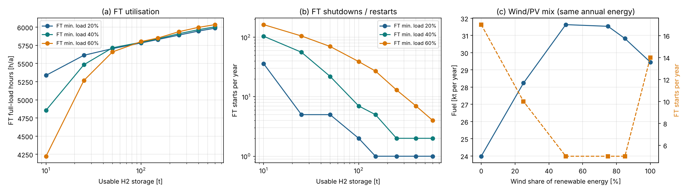

# Power-to-Liquid Plant Model: Fischer–Tropsch Synthesis in a Wind and Solar Energy System

A Python model of a Power-to-Liquid (PtL) plant that turns wind and solar electricity, water and CO₂ into synthetic liquid fuel (e-diesel/e-kerosene) with the **Fischer–Tropsch (FT) synthesis**. The project does three things:

1. It sets the FT process parameters from literature and validates the process model against a published DLR reference plant (König et al., 2015).
2. It couples the process to a full energy system: real hourly German wind and PV data, a PEM electrolyser, hydrogen storage and the FT plant.
3. It runs scenarios on storage size, FT flexibility, the wind/PV mix and electrolyser size, and evaluates the results.



## System

```
wind + PV ──► PEM electrolyser ──► H2 storage ──► RWGS (900 °C) ──► FT synthesis (225 °C, Co) ──► C5+ fuel
 (SMARD 2024     (modular,          (buffer)        CO2 + H2 ⇌ CO + H2O    ASF product distribution
  hourly data)    4.3 kWh/Nm³)                              ▲                    │
                                                            └── tail-gas recycle ┴──► purge → RWGS burner
```

| Part | Model |
|---|---|
| Renewables | Hourly German onshore wind and PV generation for 2024 from [SMARD](https://www.smard.de) (Bundesnetzagentur), scaled to a site with 300 MW wind (2 500 full-load hours) and 200 MW PV (950 full-load hours) |
| Electrolyser | PEM, 250 MW in 20 MW modules, 4.3 kWh/Nm³ H₂, 96 % rectifier efficiency |
| H₂ storage | 150 t usable (about 50 hours of FT demand) |
| RWGS | Chemical equilibrium at 900 °C (Moe correlation), water knock-out afterwards |
| FT synthesis | Cobalt catalyst, 225 °C, Anderson–Schulz–Flory (ASF) chain growth (α = 0.90), 50 % CO conversion per pass, H₂/CO = 2.05 |
| Recycle | Tail-gas recycle to the RWGS. A purge stream is burned to heat the RWGS reactor |
| FT operation | Design H₂ intake 3.01 t/h, minimum load 40 %, ramp limit 20 %/h, 24 h restart time after a shutdown |

All FT parameters and their sources are listed in [`data/ft_parameters.csv`](data/ft_parameters.csv).

## Results

### 1. Process model validation against König et al. (2015)

The reference plant is the DLR process concept by König, Baucks, Dietrich and Wörner (2015): 3.01 t/h of H₂, CO₂-based, with RWGS and cobalt FT. The model's only fitted parameter is the purge fraction. It is set so that the carbon efficiency matches the paper (73.7 %), giving a purge of 17.9 %. The other quantities are then predictions:

| Quantity | Model | König et al. (2015) | Difference |
|---|---|---|---|
| Electrolyser power (AC) | 150.0 MW | 150.1 MW | −0.1 % |
| Liquid fuel | 5.34 t/h | 5.5 t/h | −2.9 % |
| Fuel energy (LHV) | 65.2 MW | 67.1 MW | −2.9 % |
| Power-to-Liquid efficiency | 42.1 % | 43.3 % | −1.2 points |
| RWGS heat demand | 10.5 MW | 11.5 MW | −8.6 % |

A simple stoichiometric and equilibrium model reproduces the detailed Aspen Plus flowsheet within 3 % for fuel output and efficiency. The purge gas (21.9 MW LHV) covers the RWGS heat demand, so the reactor needs no extra fuel. This matches the paper, where the RWGS burner runs on fuel gas.

### 2. Fischer–Tropsch parameter study



| α | C1–C4 gas | Kerosene (C10–C14) | Diesel (C15–C20) | Wax (C21+) | Carbon efficiency | PtL efficiency |
|---|---|---|---|---|---|---|
| 0.80 | 26 % | 21 % | 11 % | 6 % | 59 % | 33.5 % |
| 0.85 | 17 % | 23 % | 16 % | 16 % | 67 % | 38.1 % |
| **0.90** | **8 %** | **19 %** | **19 %** | **36 %** | **74 %** | **42.1 %** |
| 0.95 | 3 % | 9 % | 12 % | 69 % | 78 % | 45.0 % |

- **Chain growth α is the key catalyst parameter.** Raising α from 0.80 to 0.90 cuts the light-gas loss from 26 % to 8 % and raises the PtL efficiency from 34 % to 42 %. A high α produces mostly wax, so a **hydrocracker** is needed to turn it into kerosene and diesel. That is why industrial PtL plants combine high-α cobalt FT with hydrocracking.
- **Recycle design matters as much as the catalyst.** With 50 % CO conversion per pass, cutting the purge from 18 % to 5 % raises the carbon efficiency from 74 % to 86 %. The limit is that the purge gas must still supply enough heat for the RWGS reactor. The table `results/02_conversion_purge_study.csv` shows the trade-off.

### 3. Energy-system scenarios (hourly, full year 2024)

**Baseline:** 300 MW wind and 200 MW PV, a 250 MW electrolyser, 150 t of H₂ storage and an FT plant taking 3.01 t/h of H₂.

| KPI | Value |
|---|---|
| Renewable electricity | 943 GWh/year |
| Electrolyser full-load hours | 3 507 h |
| Hydrogen produced | 17 600 t/year |
| FT full-load hours | 5 840 h (online 98 % of the year, 5 restarts) |
| **Synthetic fuel** | **31 200 t/year (381 GWh)** |
| Overall efficiency, renewable electricity → fuel | 40.4 % |
| Unused renewable electricity | 4.0 % |
| CO₂ used | about 131 000 t/year |



**Findings**

- **Hydrogen storage keeps the FT plant running.** With only 10 t of storage, the FT plant has to shut down about 100 times a year and loses 17 % of its output. About 50–100 t (17–33 hours of FT demand) brings this down to fewer than 25 restarts, and 150 t to about 5.
- **FT flexibility can replace storage.** An FT plant that can turn down to 20 % load needs only about 25 t of storage to stay at around 5 restarts. A plant limited to 60 % needs about 600 t. Each start of an RWGS/FT plant costs hours of off-spec production and stresses the catalyst. Improving part-load capability is therefore worth as much as building storage.
- **Wind and solar complement each other.** At the same annual energy, a 50/50 to 75/25 wind/PV mix gives 7 % more fuel than wind alone and 32 % more than PV alone. It also needs the fewest restarts (5 per year against 14 for wind alone and 17 for PV alone).
- **The electrolyser should be about half the renewable capacity.** Above 250 MW (0.5 × the renewable capacity), more electrolyser capacity adds no fuel, because the FT plant and the storage become the bottleneck.
- **Production is seasonal.** Fuel output is about 3 300 t in January but only 2 100 t in August, because North German wind is stronger in winter.

**Maritime context.** 31 200 t of e-fuel per year is the annual fuel demand of about 14 short-sea cargo ships of 5 000 dwt (12 kn, 2 400 kW, 5 000 sea hours per year). That shows the scale of renewable power needed to decarbonise shipping with e-fuels: 500 MW of wind and PV for 14 small ships.

## Limitations and next steps

- The process model is steady state, with stoichiometric FT and equilibrium RWGS. Part-load efficiency is assumed constant, and no reactor kinetics are included. A next step is a Yates–Satterfield-type kinetic model, with per-pass conversion depending on load and temperature.
- The wind and PV shapes are German national totals, which are smoother than a single site. A single wind farm needs more storage.
- The plant is off-grid with no electricity purchase, and there are no costs yet. The next step is levelised cost of fuel with CAPEX/OPEX from literature, including grid backup and electricity prices from SMARD.
- Hydrocracking and product upgrading are not modelled. All C5+ is counted as fuel.
- The CO₂ is assumed to be available (for example from a biogenic point source). Direct air capture energy is not included.

## Run it yourself

```bash
pip install -r requirements.txt
python scripts/fetch_smard.py 2024     # optional: data/smard_2024_DE_wind_pv.csv is included
python scripts/run_study.py            # validation, parameter studies and scenarios (about 2 minutes)
```

Change the site and plant in `src/energy_system.py` (`Site`, `Plant`) or the process in `src/ft_process.py` (`FTParams`).

## Project structure

```
src/ft_process.py        RWGS equilibrium, FT with ASF distribution, recycle loop, efficiencies, calibration
src/energy_system.py     hourly simulation: renewables -> electrolyser -> H2 storage -> FT operation strategy
scripts/fetch_smard.py   downloads hourly wind and PV generation from SMARD
scripts/run_study.py     validation, FT parameter studies, system scenarios, figures
data/                    SMARD 2024 profiles, FT parameter table with sources
results/                 CSV tables and figures
```

## References

- König, D. H., Baucks, N., Dietrich, R.-U., Wörner, A. (2015). Simulation and evaluation of a process concept for the generation of synthetic fuel from CO₂ and H₂. *Energy* 91, 833–841.
- Moe, J. M. (1962). Design of water-gas shift reactors. *Chemical Engineering Progress* 58(3), 33–36.
- Anderson–Schulz–Flory distribution: e.g. Schulz, H. (1999). Short history and present trends of Fischer–Tropsch synthesis. *Applied Catalysis A* 186, 3–12.
- Bundesnetzagentur | SMARD.de, hourly electricity generation data, licence CC BY 4.0.

---
Developed with AI-assisted coding (Claude, Anthropic). I ran, validated and extended the analysis.

Muhammad Maaz Asmat · Mechanical Engineer, M.Sc. student in Sustainable Maritime Operations (Hochschule Emden/Leer)
